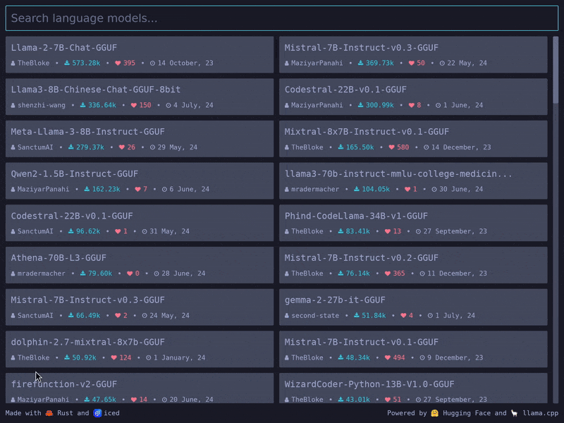

<div align="center">

# Icebreaker

[](https://crates.io/crates/icebreaker)
[](https://github.com/hecrj/icebreaker/blob/master/LICENSE)
[](https://crates.io/crates/icebreaker)
[](https://github.com/hecrj/icebreaker/actions)
[](https://github.com/iced-rs/iced)

A local AI chat app powered by 🦀 Rust, 🧊 iced, 🤗 Hugging Face, and 🦙 llama.cpp



</div>

## Installation

No pre-built binaries yet! Use `cargo` to try out the latest release:

```bash
cargo install icebreaker
```

Or build directly from `master`:

```bash
cargo install --git https://github.com/hecrj/icebreaker.git
```

### NixOS

Icebreaker is packaged in [nixpkgs](https://github.com/NixOS/nixpkgs) (maintained by [DerGrumpf](https://github.com/DerGrumpf)) as `icebreaker-chat` (the name `icebreaker` was already taken by an unrelated package):

```bash
nix run nixpkgs#icebreaker-chat
```

Or add `pkgs.icebreaker-chat` to your configuration's `environment.systemPackages`.

> [!Note]
> This package isn't in a stable NixOS release yet; use `nixpkgs-unstable` or `master` until it lands.

## Why "Icebreaker"?

[Blame Mistral!](assets/naming.png)
